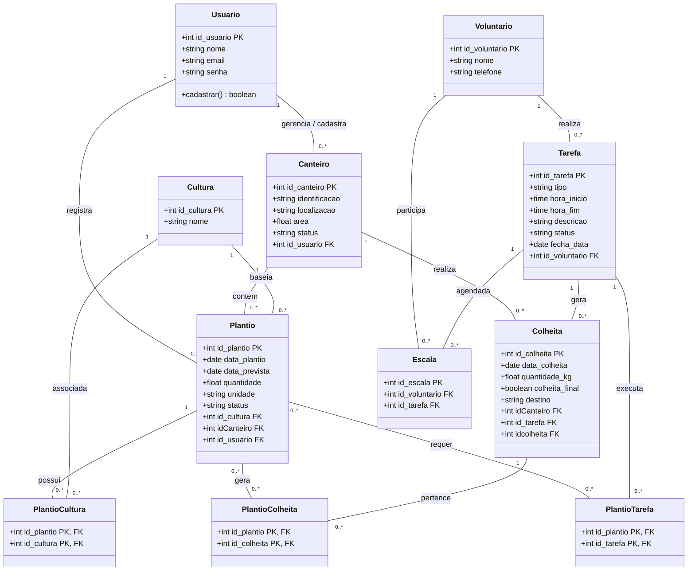

# Diagrama de Classes - Horta Escolar

## Histórico de Versões
| Versão | Data | Descrição | Autor |
| :---: | :---: | :--- | :--- |
| **v1.0** | 09/11/2026 | Modelo conceitual de classes derivado do BD relacional| Hiago Correia de Souza |
| **v2.0** | 10/11/2026 | adição do método cadastrar () na classe usuário | Hiago Correia de Souza |
## Diagrama de Classes

